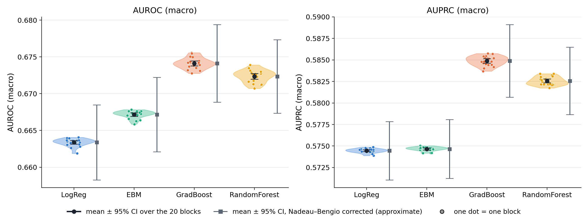

# Interpretable Model versus Explained Black Box in Hospital Readmission Prediction

Advanced Topics in Artificial Intelligence, Wrocław University of Science and Technology (PWr). Solo course project, supervised by Prof. Maciej Huk.

## Research question

Is an inherently interpretable model good enough to predict 30-day hospital readmission, or do we need a black-box model plus post-hoc explanations? How big is the performance gap, is it statistically reliable, and does it matter in practice?

## Dataset

[Diabetes 130-US Hospitals for years 1999–2008](https://archive.ics.uci.edu/dataset/296/diabetes+130-us+hospitals+for+years+1999-2008) (UCI repository, id 296). The target is whether a patient was readmitted within 30 days.

The raw files are not stored in this repo. Download the dataset and place `diabetic_data.csv` and `IDS_mapping.csv` in the `data/` folder.

## Models

| Model | Type |
|---|---|
| Logistic Regression | interpretable (linear) |
| EBM (Explainable Boosting Machine) | interpretable (glass-box additive model) |
| HistGradientBoosting | black box |
| Random Forest | black box |

## Method (Experiment 1)

- **Patient-wise cross-validation:** 5-fold `StratifiedGroupKFold`, repeated 20 times with different shuffles. All encounters of one patient stay in the same fold, so no patient appears in both training and test data.
- **Blocks:** the 5 fold scores of one repeat are averaged, which gives 20 blocks per model.
- **Measures:** AUROC, AUPRC, PPV, TPR and F1 (macro, micro and weighted versions) and the Brier score, 16 in total. The decision threshold for PPV, TPR and F1 is the training prevalence.
- **Tests:** Friedman test (the rank-based, non-parametric counterpart of repeated-measures ANOVA), then paired Wilcoxon signed-rank tests for every model pair.
- **Multiple-comparison corrections:** Holm, Hochberg, Hommel, Finner, Shaffer and Bergmann–Hommel were all implemented and compared.
- **Effect sizes:** raw mean difference with bootstrap 95% CI, paired Cohen's d, rank-biserial correlation, and Kendall's W.
- **Confidence intervals:** (a) a plain t-interval over the 20 blocks, which only captures reshuffling noise, and (b) the Nadeau–Bengio corrected interval, which accounts for overlapping training sets and is much wider.
- **Verification:** the statistics were recomputed independently in R (`scripts/`).

## Main results

Mean ± standard deviation over the 20 blocks:

| Model | AUROC | Brier score (lower is better) |
|---|---|---|
| Logistic Regression | 0.6634 ± 0.0005 | 0.09683 ± 0.00003 |
| EBM | 0.6672 ± 0.0005 | 0.09666 ± 0.00002 |
| HistGradientBoosting | 0.6741 ± 0.0007 | 0.09569 ± 0.00005 |
| Random Forest | 0.6724 ± 0.0008 | 0.09641 ± 0.00003 |



Key points:

- With 20 blocks the p-values are tiny, so statistical significance alone says little. The effect sizes matter: the best AUROC gap between the interpretable Logistic Regression and the best black box is about 0.011.
- Under the Nadeau–Bengio interval (half-width about ±0.005 for AUROC), HistGradientBoosting and Random Forest cannot be separated.
- All six correction methods give the same decisions on these tests.
- Whether a difference of this size is clinically relevant is an open question. There is no agreed minimal clinically important difference for this task.

The calibration curves are in `results/experiment1/calibration_4models.png`.

## Repository structure

```
README.md
pyproject.toml, poetry.lock   Python environment (Poetry)
data/                         raw dataset (not uploaded)
notebooks/                    00_exploration.ipynb: the full experiment
scripts/                      R scripts that verify the Python results
results/                      results tables, figures, per-measure score matrices
```

## How to reproduce

1. Install the Python environment: `poetry install`
2. Put `diabetic_data.csv` and `IDS_mapping.csv` in `data/`.
3. Run `notebooks/00_exploration.ipynb`. The cross-validation cells take several hours.
4. Run the R checks from the repository root, for example: `Rscript scripts/effect_check.R`

## Status

Experiment 1 (predictive performance and statistics) is done. Planned next: Experiment 2 (feature importance) and Experiment 3 (surrogate decision tree explaining the black box).